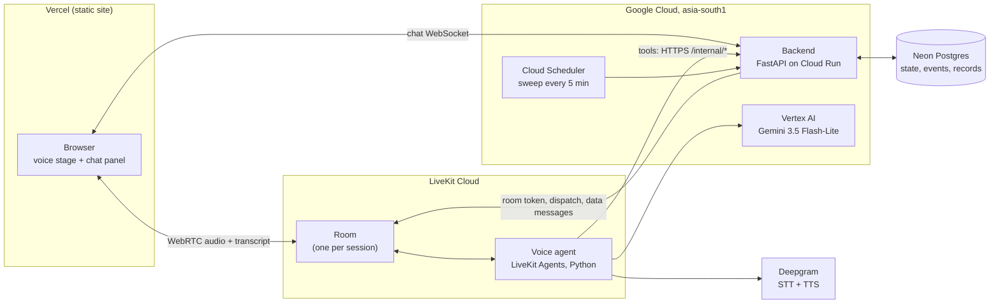

# Flight Change Agent

A voice + chat agent that helps an airline customer change an existing flight booking. The user talks on a web call and types the awkward details (booking reference, names, flight choice, fare consent) in a web chat. Both channels share one session. The session ends in one sanitized, versioned record.

- **Live:** https://flight-change-agent.vercel.app (backend: https://flight-backend-820256992821.asia-south1.run.app)
- **Architecture diagrams:** [docs/architecture.html](docs/architecture.html) (open the file in a browser)
- **Brief:** [Hunar.ai AI Engineer assignment](https://github.com/Hunar-ai/ai-engineer-assignment)
- **Also:** [manual test script](docs/TESTING.md), [record JSON Schema](docs/record.schema.json), [design spec](docs/superpowers/specs/2026-11-07-flight-change-agent-design.md), [build log](BUILD_LOG.md)

**Try it with these seeded bookings** (dates move with today; type names in any case):

| PNR | What it shows |
|---|---|
| `ABC123` | 1 passenger, `RAHUL SHARMA`, saver fare (₹3,000 change fee) |
| `PQR456` | 2 passengers, `ANANYA IYER` and `KARTIK IYER` |
| `FLX789` | flex fare, `MEERA NAIR`: a cheaper flight gives a refund |
| `CNX111` | cancelled booking (rejected) |
| `OLD222` | already flown (rejected) |
| `SON333` | departs in under 3 hours (rejected) |

## Architecture and shared state



- **The backend is the single source of truth.** Each session is one JSONB state row in Postgres. The page and the agent are thin clients.
- **One pure function changes state.** Every change is an engine command, `(state, input, now) -> (state, events, reply)`. It does no I/O and never reads the clock.
- **One transaction per change.** `apply` locks the row (`SELECT ... FOR UPDATE`), runs the command, decides the outcome, writes the state, events and any record, then commits.
- **The event log drives the chat.** Each event has an id. The chat socket replays events after `?after=<id>`. A fresh page also gets the spoken call lines, in time order, so a reload shows the whole conversation.
- **Chat to call.** A chat answer during a call goes into the LiveKit room as a data message (topic `session-events`). It says what was saved and which chat box is open next. The agent acknowledges it when nobody is speaking.
- **Call to chat.** The agent calls backend tools (`/internal/sessions/{id}/*`). They run the same engine and push the result to the chat socket.
- **One input at a time, on both channels.** The engine has at most one open card. The next one opens only when it is answered (the optional email too: type it or tap Skip). While a card is open, the agent asks no new spoken question.
- **The agent keeps no state it cannot rebuild.** On start it reads `/context`: field status, open card, focus, the last 20 transcript turns, and never passenger names.
- **Call me back.** After a call ends, the call button reads "Call me back" and the thread offers the same. The new call opens with "Welcome back" and the current step. The agent tells a callback from a crash by whether the last call ended cleanly.
- **Debug view.** The Debug button opens the session timeline (`GET /sessions/{id}/timeline`): both channels, every agent tool call with its arguments and the backend's reply, state changes, per-turn latency, cost, and record revisions with delivery times.
- **UI.** A voice stage (LiveKit's Aura orb, mute, mic picker) next to one chat thread. The thread has the live transcript, the agent's questions with their inputs (date picker, choices, flight list, fare table), the user's answers and the final record card.

## How the record is built and sanitized

**Fields** (8; all times ISO 8601 with `+05:30`):

| Field | Channel | Required | Validation and normalization |
|---|---|---|---|
| `changeReason` | call | yes | 3 to 500 characters, not a bare greeting ("hey", "okay"). Tagged with a category: `schedule`, `personal`, `medical`, `missedFlight` or `other`. |
| `newTravelDate` | call | yes | ISO date only. The agent looks dates up in a 2-week calendar in its prompt and reads back the backend's wording ("Friday 13 November 2026"). Not past, at most 330 days ahead, not the current flight's day. |
| `timeFlexibility` | call | yes | `morning`, `afternoon`, `evening` or `any` ("any time" and "flexible" map to `any`). |
| `pnr` | chat | yes | Uppercased, spaces removed, 6 letters or digits. Must exist, be `confirmed`, not flown, and depart in more than 3 hours. |
| `passengerNames` | chat | yes | One card per passenger. Uppercased; punctuation and titles (MR, MRS, DR...) removed. Each must match a different name on the booking. Errors never show the real names. |
| `contactEmail` | chat | no | Lowercased, basic pattern with a dotted domain. Skip is allowed. |
| `selectedFlight` | chat | yes | Must be one of the offered flight ids. Options come from the route, date and time window. |
| `fareAcceptance` | chat | yes | A yes/no card with the full breakdown. A quote older than 10 minutes is re-priced; if the amount changed, the user is asked again. |

**Fare math:** `net = (newFare - oldFare) x passengers + changeFee x passengers`. A positive net is paid. A negative net is refunded to the original payment method.

**Conflicts** (the call and the chat give different values for one field):
- **Chat-native fields** (`pnr`, `passengerNames`, `contactEmail`): the typed value wins at once, because STT mangles letters and digits. Logged as `resolution: "chatValue"`, `reason: "typed value preferred over spoken"`.
- **Call-native fields** (`changeReason`, `newTravelDate`, `timeFlexibility`): the field becomes `invalid` until the user picks one (by voice, or with a select card in chat). If the session goes idle with it open, the outcome is `needsReview`.
- **Every conflict is listed in the record,** resolved or not.

**Sanitization:** the record holds normalized values only. Passenger names appear only in `fields.passengerNames`. The booking block has the route, original flight, fare class and the masked payment method.

## Outcomes, delivery and revisions

| Outcome | When |
|---|---|
| `completed` | A change request with every required field valid and the fare accepted. Built at once. |
| `needsReview` | The user asked for a refund instead (built once the reason, PNR and names are valid), or the session went idle with an unresolved call-native conflict. |
| `optedOut` | The user confirmed "stop", by voice or with the chat's Stop button (a confirm card comes first). |
| `partial` | No call connected, no user activity for 30 minutes, and required fields missing or invalid. Set by the sweep. |

- **Precedence:** `optedOut` > `needsReview` > `completed` > `partial`.
- **Revisions:** every record has `revision`, starting at 1. `partial` is not final: if the user comes back and answers, the session reopens and the next end state is revision N+1. The other outcomes lock the session; the chat then shows the record and accepts no input.
- **Exactly once:** the record goes into an outbox table with key `(sessionId, revision)`, in the same transaction as the state. Delivery POSTs it to a stub endpoint on the backend (`/stub/records`) with `Idempotency-Key: {sessionId}:{revision}`, and the stub ignores a repeated key. Delivery runs right after the write, on every sweep and on startup, so a restart between write and delivery still delivers once. The record is also logged as one JSON line and shown in the chat.
- **If the call is live** when the record is built, the agent reads a short summary, says goodbye and hangs up. It cannot hang up before that unless the caller says they must leave.
- **To see a delivered record:** `GET /stub/records?sessionId=<id>`.

## Stack and cost per session (150 words or fewer)

- **Voice:** LiveKit Cloud and LiveKit Agents (Python), hosted on LiveKit Cloud. It gives WebRTC, barge-in, turn detection and call-drop reconnects, which saved the most work.
- **STT / TTS:** Deepgram Nova-3 streaming and Aura-2. Fast, cheap, good on Indian English.
- **LLM:** Gemini 3.5 Flash-Lite on Vertex AI (`asia-south1`, minimal thinking), with 3.1 Flash-Lite as a fallback. It was the cheapest model with fast tool calls. A small Groq model tags the reason category.
- **Backend:** FastAPI on Cloud Run with Neon Postgres. Web: React on Vercel.
- **Cost:** about **$0.055 per completed session** with a call (measured: STT $0.019, TTS $0.030, LLM $0.011, hosting $0 on free tiers).

## Cost and latency

- **How cost is measured:** the agent reports STT audio seconds, TTS characters and LLM tokens from LiveKit metrics to `/usage`. The backend prices them with the table in [backend/app/telemetry/pricing.py](backend/app/telemetry/pricing.py) and writes `costUsd` into each record.
- **How latency is measured:** for each agent turn, the agent joins three LiveKit metrics by speech id: end-of-utterance delay + LLM time to first token + TTS time to first byte. Their sum is the time from the user stopping to the first agent audio.
- **Numbers** (deployed system, 42 agent turns over 13 calls, 2026-11-08):

| | p50 | p95 |
|---|---|---|
| **Voice latency** | **1.73 s** | **7.6 s** |
| End of utterance | 0.80 s | |
| LLM first token | 0.50 s | |
| TTS first byte | 0.34 s | |

- **Caveats:** most of these calls were scripted test calls with synthesized speech, and some ran during a slower model trial. The p95 comes from turns where the LLM chains two tools before it speaks.
- **Cost:** mean $0.0546 over 3 completed sessions with a call (p50 $0.053, max $0.065).

```bash
cd backend && uv run python ../scripts/latency_report.py --database-url "$NEON_DATABASE_URL" --since 2026-11-08
```

## Product decisions where the brief was vague

- **Scenario: flight change.** Almost every check can be done by machine, so a person is needed only for refunds and unresolved conflicts.
- **The agent never books or charges.** It collects, validates, quotes and gets consent. A downstream service executes.
- **Typed wins for letters and digits.** Spoken PNRs and names are only hints.
- **One input at a time, everywhere.** Every card blocks until it is answered, and the call agent waits for it too.
- **Email before the fare.** Fare acceptance is the last step, so it can close the session at once.
- **Declining the fare does not end the session.** The flight list is offered again.
- **Three failed tries** on a field: the agent offers to stop. No `needsReview` for this.
- **30 minutes idle** before `partial`. The sweep runs every 5 minutes.
- **Limits for a public URL:** calls end at 10 minutes, at most 5 calls at once, 10 new sessions per network per hour, and a daily session cap.
- **If nobody calls within 20 seconds,** the chat starts asking on its own (no LLM), with the call fields as cards.
- **New chat starts a new session.** One thread per session; old session URLs still open.

## Edge cases

**Handled**
- A double-clicked Submit, an answer to a cancelled card, or two tabs answering one card: the first wins; the rest get "This question is no longer open." (row lock + card id check).
- Messy tool values from the LLM (`"Dec 13th"`, a lowercase PNR with spaces, an unknown field): the tool gets `{ok:false, error}` with a sentence it can say.
- A restart after a record is written but before delivery: delivered once on startup.
- The sweep never marks a session `partial` while a call is live or the user was active in the last 30 minutes. A stale call flag (no agent signal for 15 minutes) is reset.
- The date or time window changes after flights were listed: the open flight or fare card is cancelled and a new list is offered.
- No flights match (or all are sold out): no empty list. The user is asked for another date or a wider window.
- A page reload during or after a call: the whole thread comes back, spoken lines included. The room stays 2 minutes, so the same agent continues.
- An agent restart: the new agent rebuilds context and says "Sorry, we got cut off" before asking again. A call back after a clean hang-up opens with "Welcome back" instead.
- A switch to a refund while a chat box is open: the agent waits for the remaining details and does not say goodbye early.

**Not handled**
- Round trips, multi-segment bookings, changing only some passengers.
- Languages other than English.
- A user who blocks the microphone gets only the chat (which still works end to end).
- Barge-in was tested with synthesized speech, not by people on real mics in every browser.
- More than one backend instance (the chat hub is in-process, so Cloud Run runs one instance).
- Timestamps in a reloaded thread show the reload time, not the original time.

## What I trust least

- **LLM tool discipline.** The prompt asks the model to save answers, read dates back and wait for chat boxes. The backend enforces the rules that matter (validation, one card, no names, no hang-up on an open request), but the conversation quality still depends on the model following the prompt.
- **Tail latency.** p50 is fine; p95 is high on turns that chain two tool calls before speaking.
- **The in-process chat hub.** It is correct only with one backend instance.

## What I would do next with another week

- Measure latency over 20+ calls by real people, then tune endpointing and try preemptive generation.
- Optional document upload (a doctor's note for medical reasons) with a vision check.
- Hindi and one more Indian language.
- Move the chat hub to Postgres `LISTEN/NOTIFY` so the backend can run more than one instance.

## AI tools

- **Helped:** turning the brief into a spec and a test-first plan, test-first work on the engine and outcome rules, and reading the installed LiveKit Agents API instead of guessing.
- **Misled:** the plan assumed a LiveKit helper that does not exist in Agents 1.8; the LLM sometimes skipped an "optional" tool, so the backend now tags the reason category itself; and the model said goodbye early in a refund run, so the backend now blocks the hang-up. Each was caught by a test or a live run.
- **Model choice:** the first live test ran on Groq's free tier, which hit its rate limit within a few turns. Gemini 3.1 Flash-Lite was cheaper but slow on tool turns (7 to 9 s). Gemini 3.5 Flash-Lite on Vertex AI was the best fit.

## Run locally

Needs Python 3.12 with `uv`, Node 20+, Postgres 16 on port 5433 (`docker compose up -d db`, or a local db `flight`, user/pass `dev`/`dev`), LiveKit Cloud and Deepgram keys in your environment, and `gcloud auth application-default login` for Gemini on Vertex AI. `GROQ_API_KEY` is optional (without it the reason category is `other`).

```bash
cd backend && uv sync && SERVICE_TOKEN=dev-token uv run uvicorn app.main:app --port 8080
```

```bash
cd agent && uv sync && uv run python agent.py download-files && BACKEND_URL=http://localhost:8080 SERVICE_TOKEN=dev-token GOOGLE_CLOUD_PROJECT=<your-project> uv run python agent.py dev
```

```bash
cd web && npm install && echo "VITE_SERVER_URL=http://localhost:8080" > .env.local && npm run dev
```

Tests (the backend tests use a `flight_test` database on port 5433):

```bash
cd backend && uv run pytest -q
```

```bash
cd agent && uv run pytest -q
```

## HTTP endpoints

```bash
API=https://flight-backend-820256992821.asia-south1.run.app
SID=$(curl -s -X POST $API/sessions | jq -r .sessionId)
curl -s -X POST $API/sessions/$SID/answers -H 'content-type: application/json' -d '{"value":"ABC123"}' | jq .openCard.label
curl -s -X POST $API/sessions/$SID/answers -H 'content-type: application/json' -d '{"value":"Rahul Sharma"}' | jq .openCard.label
curl -s $API/sessions/$SID/timeline | jq .summary.fields.pnr
```

- **Public:** `POST /sessions`, `GET /sessions/{id}` (with the open card), `POST /sessions/{id}/answers`, `POST /sessions/{id}/stop`, `GET /sessions/{id}/timeline`, `POST /sessions/{id}/call-token`, `WS /chat?sessionId=&after=`, `GET /stub/records?sessionId=`, `GET /health`.
- **Answer as the user over HTTP:** `POST /sessions/{id}/answers` with `{"value": ..., "requestId": "<optional>"}` runs the same engine command as the chat socket. Without `requestId` it answers the open card. If no card is open and no call is live, it first opens the next one (no 20 s wait). The reply has `ok`, `openCard`, `outcome` and `locked`. A rejected value returns 422 with `error`; a stale card or a finished session returns 409. `POST /sessions/{id}/stop` opens the stop confirm card; answer it with `true` to opt out. A page open on the same session shows HTTP answers after a reload.
- **Internal** (header `Authorization: Bearer $SERVICE_TOKEN`): `GET /internal/sessions/{id}/context`, and `POST` to `.../fields`, `.../chat-input`, `.../conflicts/{field}/resolve`, `.../refund-instead`, `.../opt-out`, `.../focus`, `.../reason-category`, `.../call`, `.../transcript`, `.../usage`, `.../metrics`, plus `POST /internal/sweep` and `POST /stub/records`.

## Deploy

- **Backend:** from `backend/`, `gcloud run deploy flight-backend --source=. --region=asia-south1 --max-instances=1 --timeout=3600 --allow-unauthenticated`, with secrets from Secret Manager.
- **Agent:** from `agent/`, `lk agent deploy`. Agent secrets: `DEEPGRAM_API_KEY`, `SERVICE_TOKEN`, `BACKEND_URL`, `GOOGLE_CLOUD_PROJECT`, `GOOGLE_CLOUD_LOCATION`, and `GOOGLE_CREDENTIALS_JSON` (a key for a service account with only the Vertex AI User role).
- **Web:** from `web/`, `vercel --prod`. `VITE_SERVER_URL` (the backend URL) is a Vercel production env var. The backend's `ALLOWED_ORIGINS` must include the Vercel URL.
- **Sweep:** a Cloud Scheduler job every 5 minutes calls `POST /internal/sweep` with the service token.
